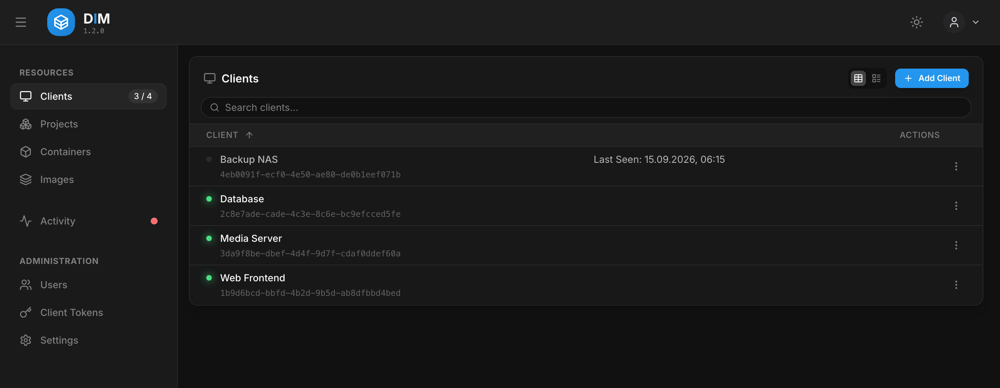
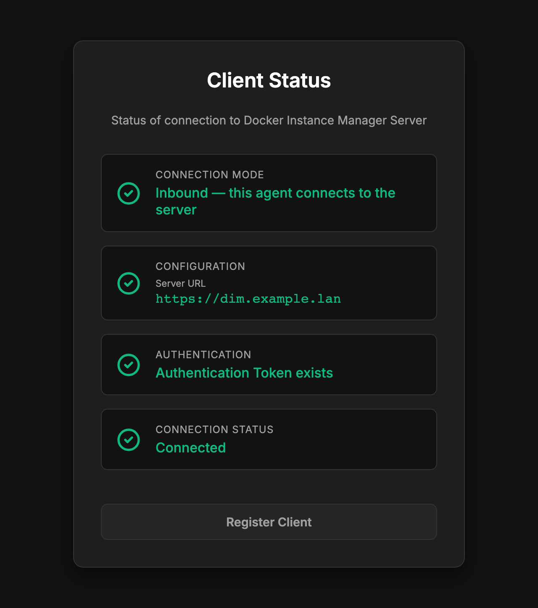

# Clients

A **client** is one Docker host, managed through the DIM agent running on it. This page covers
connecting hosts, editing and removing them. The [Quick Start](../quickstart.md) walks through
the first one.



The dot in front of a client is its **live connection**, not a stored status; the sidebar badge
counts online clients against all of them. A click on a client opens its containers, images,
volumes and networks, each list with its own actions and the host's activity below.

## The overview

DIM opens on the **Overview**. Its first card says how the fleet is doing — *Healthy*,
*Degraded* or *Critical* — and how many **findings** there are. Below the cards, *Needs
attention* lists them, each with a link to where it can be dealt with: a host that is offline or
cannot reach Docker, a container that is dead, restarting, unhealthy or ended with an error, an
update that failed, a container in two projects, an outdated agent, a registry paused by a rate
limit. A finding disappears by itself once its cause is gone: unlike an entry in the activity,
it is not something that happened but something that is so right now.

The other cards show how many clients are online, how many containers have an update waiting,
how many are not running on the hosts that are connected and how many errors and warnings you
have not marked as seen. Each card leads to the list behind its number, and the numbers follow
the hosts without a reload. The badges in the sidebar show the same counts. At the bottom,
*Recent updates* lists the last containers that came up on a new image — see
[Update history](updates.md#update-history).

## Which side connects

Server and agent talk over one persistent WebSocket. Either side may open it — you choose when
adding the client, and the modes are named from the server's point of view:

| Mode | Who dials | Use it when | Agent needs |
| :--- | :-------- | :---------- | :---------- |
| **Inbound** | the agent dials the server | the host can reach the server — the usual case | `serverUrl` (set at registration) |
| **Outbound** | the server dials the agent | only the server can reach the host, e.g. a host behind NAT that the server reaches over a VPN | a reachable port (`3001`), no `serverUrl` |

Once connected there is no difference: the same messages flow, the same actions are possible.

## Inbound: the agent connects to the server

1. **Clients → Add Client** → *The agent connects to this server* → **Next**.
2. Give the **display name** the client is listed under and, optionally, the **allowed IP or
   network** it should start with. Without one, the address the agent registers from becomes
   its only allowed address.
3. **Add Client & Generate Token.** The client is listed from now on, as *Awaiting
   registration*. Its registration token is shown once and is valid for **30 minutes** and
   for one registration.
4. On the agent, open `http://<host>:3001/register` and enter the server URL, the token and
   the **setup PIN** from `docker logs dim-client`.

The agent registers under the client created in step 3: it receives its id and a permanent
auth token, stores both in `identity.json` in its data volume and connects. The register page
closes itself, and the client shows the hostname the agent reported.

If the token ran out or was lost, open the waiting client and use **Generate New Token** — the
new one replaces the old.

## Outbound: the server connects to the agent

1. Start the agent with an **empty** `serverUrl`, so it waits to be called.
2. **Clients → Add Client** → *This server connects to the agent* → **Next**.
3. Enter a display name, the **target address** (`host:port`, or `wss://host:port` when the
   agent serves TLS) and the agent's **setup PIN**.
4. **Add Client.** The server dials the agent at once; if the agent refuses, the wizard shows why.

The auth token travels in the connection URL, so an outbound agent outside a network you
control should serve TLS — see [TLS](../security.md#tls).

### Rolling out without reading logs

For agents deployed by automation, where nobody reads the PIN from the log, give the agent a
secret instead and enter that in the wizard:

```yaml
services:
    dim-client:
        environment:
            - DIM_REGISTRATION_SECRET_FILE=/run/secrets/dim_registration
        secrets:
            - dim_registration

secrets:
    dim_registration:
        file: ./dim-registration.secret
```

`DIM_REGISTRATION_SECRET` works too. Remove the secret once the agent is registered; the
agent logs a reminder.

## The setup PIN

Registering an agent decides who controls its host's Docker socket, so both ways of
registering require a PIN from the agent's own log:

- It is printed on every start of an unregistered agent (`docker logs dim-client`) and never
  written to disk. Case and the hyphen do not matter.
- After five wrong attempts it is replaced by a new one, also logged.
- It is dropped with the first successful registration.

## The agent's own pages

The agent serves two small pages on port 3001: `/register` until it is registered, and
`/status`, which shows the connection mode, the server and whether the connection is up.



`enableStatusPage: false` and `enableRegisterPage: false` in the agent's `config.yaml` switch
them off; see [Configuration](../configuration.md#agent-configyaml).

## Editing a client

**Edit** in a client's menu opens the client editor:

- **Display name.**
- **Allowed IP or network** (inbound) — where this client's connections have to come from.
  Widen it to a network (`192.168.1.0/24`) or switch the check off for a host whose address
  changes, such as one on DHCP. The editor warns when the new value would lock out the address
  the agent last connected from.
- **Target address** (outbound) — where the server dials. Saving reconnects at once, so a host
  that moved does not have to be registered again.
- **Auto-update schedule** — give this host a schedule of its own instead of the default; see
  [Updates](updates.md#schedules).
- **Auto-Prune** — prune this host on a schedule; see [below](#pruning-a-host).

## Pruning a host

**Prune** in a client's menu — on the client list and on the client's page, for a connected
client — runs `docker system prune` on that host after asking. It removes every stopped
container, every network no container uses, every image without a tag and the build cache.
Volumes and tagged images stay, even when no container uses them; the **Prune** button of a
host's image list is the one that removes unused tagged images.

### Auto-Prune

To prune a host regularly, tick **Prune this host on a schedule (Auto-Prune)** in its editor
and enter a cron expression; it starts as `0 4 * * *`, every day at 04:00. Auto-prune is off
for every host until it is switched on here. The agent runs the schedule itself, in its own
time zone, whether the server is reachable or not, and removes the same things as **Prune**.
It waits for an auto-update run that is under way, so it never removes a container that run
is recreating. A run missed while the agent was down is not made up; the next date clears up
the same.

Each run appears in the activity as *Auto-prune: system:prune completed* (or *failed*), and the
client list's **Last Auto-Prune** column says when the host last pruned. Auto-prune needs an
agent of the release that introduced it; the editor says when the connected one is older.

## Removing and re-registering

**Delete** removes the client from DIM: its record and the cached Docker state. Nothing on the
host is touched; the agent keeps running, and its connection is refused from then on.

To register an agent again — after reinstalling it, or to move it to another server — delete
`identity.json` from its data volume and restart it:

```bash
docker compose exec dim-client rm /app/client/data/identity.json
docker compose restart dim-client
```

It prints a new setup PIN and opens its register page again.

To keep an **inbound** client — its id, settings, projects and activity — use **Re-register
Agent** in the client's menu and register the agent with that token. The agent connected so
far keeps working until the new one registers, and is refused from then on. The allowed IP or
network stays as the client has it.

An outbound client is registered again by adding it once more in the wizard; that creates a
new client entry, and the old one can be deleted.

## Updating the agent

The agent runs in a container like any other and is updated the same way: **Pull & Recreate**
on the `dim-client` container, or auto-update via the label. The agent recognises its own
container and hands the recreate to a short-lived helper, so the update does not cut the
branch it sits on.
