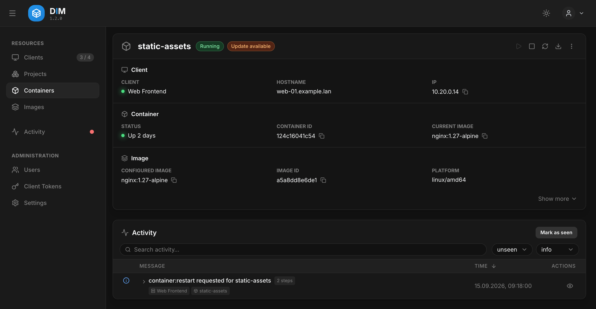
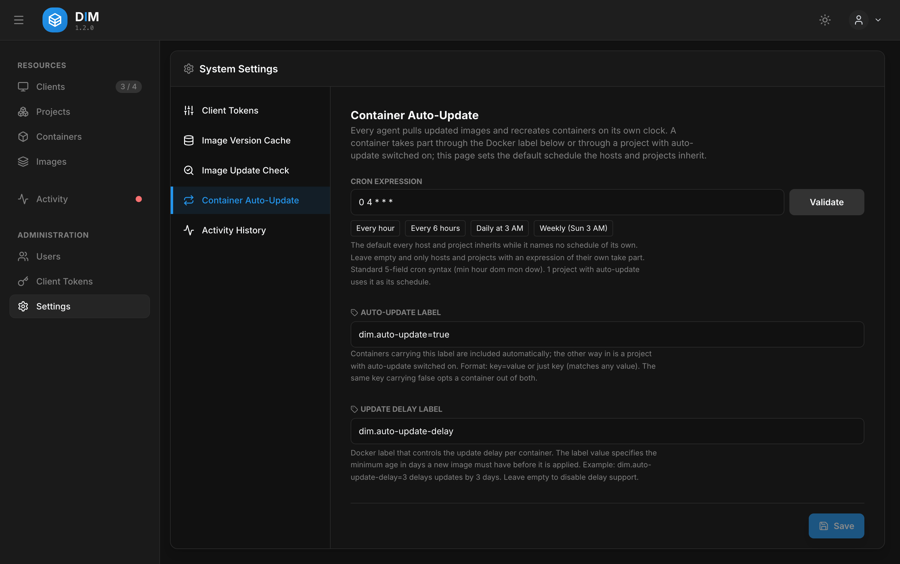
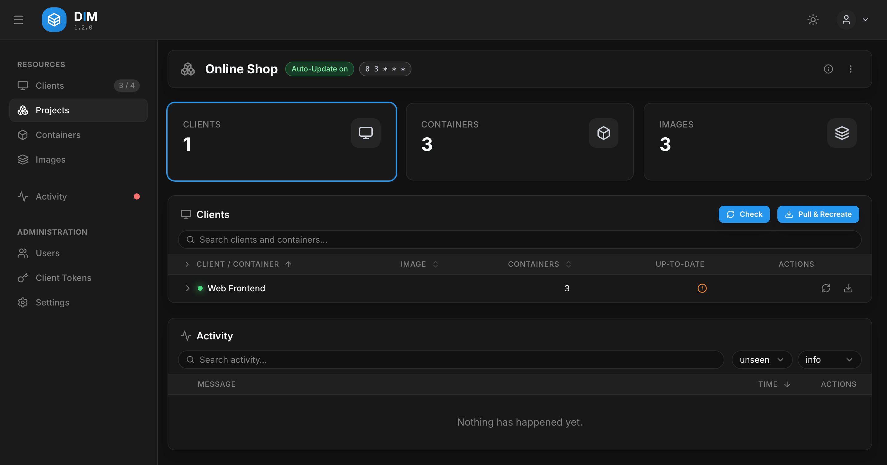

# Updates & Auto-Update

DIM answers two questions for every container: *is its image behind the registry?* and — if you
want it to — *update it, on a schedule, without me.*

## Checking for updates

A check compares the digest of the local image with the one the registry currently serves for
the same tag and platform. It works for **public images** on Docker Hub, `ghcr.io` and
`lscr.io`; the check sends no credentials, so a private repository, or a registry that insists
on a login, shows up as *could not be checked*.

- **By hand:** every list has a **Check** button in its header and in each row. The header's
  button checks what the list shows: everything while nothing narrows the list, only the hits
  while a search or a filter does. It asks first and says how many containers, images,
  projects or clients it is about to check, and whether that is the whole list or only what
  the search leaves; a row's button checks at once. Containers, images, projects and a single
  host all work the same way.
- **For a selection:** the container and image lists have a checkbox in front of every row.
  Once you pick rows, the header's buttons act on them alone, and every one of them asks
  first and says how many containers or images it is about to reach. Pull & recreate, and for
  containers start and stop, act on the picked rows only and stay disabled until something is
  picked. The number picked is shown behind
  the list's title; clear the checkboxes to act on the whole list again.
- **On a schedule:** **Settings → Image Update Check** sets an interval; `3600` checks every
  image of every host once an hour. Off by default. A registry that answers with a rate limit
  is paused for as long as it asks, the others carry on.

The **Up-to-date** column then shows ✓ (up to date), ↑ (update available) or ? (never checked,
or the registry could not answer); a dash stands for an image there is nothing to check for.
Pointing at the icon says which it is. For an image with an update, its page also shows what the
registry says about the new image — version, build date, source.

The container list can be narrowed to what needs a look: the two filters next to its search
show only the containers that have an update, are up to date or were never checked, and only
those that run, do not run or sit on a host that is offline. The **Updates available** and
**Containers not running** cards of the overview open the list with that filter already set,
and the address keeps it, so the filtered list can be bookmarked.

## Pull & Recreate

**Pull & Recreate** pulls the newer image and recreates the containers that run it, with their
configuration unchanged. It is scoped to where you click it:

| Clicked on | Recreates |
| :--------- | :-------- |
| a container | that container |
| an image (one host, or across hosts) | every container on that image |
| a project | the project's containers only — other containers on the same image are left alone. A dialog asks whether to recreate only those with an update, or all of them (*force*). |



What happened — stop, recreate, start, healthy or not — appears in the activity list as one
group per click; see [Activity](activity.md).

When the agent's own container is among them, the agent replaces itself **last**, once every
other action on that host is done. Until it is back, the host refuses new actions with
*Agent is replacing itself* — retry once it shows as connected again. How long it waits for the
others is `selfUpdateWaitSeconds` in the [agent's config](../configuration.md#agent-configyaml).
If the new agent does not come up healthy, it is rolled back to its previous release, and the
activity list says so.

## Auto-update

Auto-update runs **in the agents**, on each host's own clock. The server only tells every agent
what to update when; the agent then checks the registry, pulls and recreates by itself — and
keeps doing so while the server is down. The report arrives once the server is back.

### Which containers take part

A container takes part if **either**

- it carries the auto-update **label** — `dim.auto-update=true` by default, or
- it belongs to a [project](#projects) with auto-update switched on.

The same label key set to `false` (`dim.auto-update=false`) opts a container out of both.

```yaml
services:
    app:
        image: ghcr.io/example/app:2
        labels:
            - dim.auto-update=true
            - dim.auto-update-delay=3      # optional: only images at least 3 days old
```

The **delay** label postpones an update until the new image is a given number of days old — a
simple guard against a broken release. Both label names can be changed under
**Settings → Container Auto-Update**. The **Auto-Update** column in the container lists shows
what enrols each container: *Label*, or the project's name.

### Schedules

Schedules are cron expressions (`0 3 * * *` = daily at 03:00) and are inherited from the top
down. Each agent reads an expression **in its own time zone**, not in the browser's: in a
container that is UTC unless the agent is given `TZ` (see
[Time zones](../configuration.md#time-zones)). The client page shows the zone every agent
reported, and when its next run is due.

The **Last Auto-Update** column of the client list shows when each host last ran its
auto-update — any of its schedules, whether the run changed anything or not. A run with
nothing to do leaves no entry in the activity; the column still moves.

| Level | Set in | Applies to |
| :---- | :----- | :--------- |
| Default | **Settings → Container Auto-Update** | every host and project without a schedule of its own |
| Host | client editor → *own schedule* | the host's labelled containers that are in no project |
| Project | project editor | the project's containers, on every host |



With an empty default only hosts and projects that name a schedule of their own are updated.
A container in a project follows the project's schedule even if its label enrolled it, so a
project's containers are always updated together.

The **Next Auto-Update** column of the container lists shows how long it is until the schedule a
container follows next runs on its host — the project's for a container in a project, the
host's for every other one, each as inherited from the table above. The tooltip gives the date
and the expression. A row for a container on several hosts shows the earliest of them; *due*
means the time has passed and the host has not reported the run yet, typically because it is
offline. The column stays empty for a container that takes no part, and for a host whose agent
predates the report until it is updated.

**A run** first pulls every image that is due, and only then recreates the containers — a
project whose third image fails to pull is not left half on the new release. A host that was
off at the scheduled time makes the run up once, a few minutes after it starts. A run that
changed nothing reports nothing.

## Update history

DIM keeps a record of every container that came up on a new image, on every host, and shows it
in two places: the **Overview** lists the last ten under *Recent updates*, and **Updates** in the
sidebar has all of them, with a search and filters for trigger and result.

**What counts as an update** is a container that runs a different image than before under the
same name. The agent compares what it sees with what it saw last, so it notices updates
**whoever made them**:

| Trigger | Means |
| :------ | :---- |
| **Auto** | The [auto-update](#auto-update) recreated the container. |
| **Manual** | *Pull & Recreate* or *Recreate* from the dashboard. |
| **External** | Something else on the host: `docker compose pull && docker compose up -d`, Watchtower, Portainer, a `docker run` by hand. |

Each entry names the version it went from and to — the `org.opencontainers.image.version` label
where the image carries one and it changed, otherwise the digest. A rebuild of the same release,
which keeps its label, therefore shows the digests. A container recreated on the same image, for
example after a change to its Compose file, is not an update; one removed and started again on a
newer image within a day is.

**Failed updates** are listed in red with the reason, for the updates DIM carried out itself: a
pull that failed, a container that could not be replaced, a self-update that was rolled back.
DIM cannot know about an external update that failed.

- **The history starts with the agent.** A host's entries begin once its agent is on a release
  with the update history; its first start only takes note of what is running. Hosts whose agent
  is older are named above the list.
- **Updates while the agent was down** are found when it starts again, timed by when the new
  container was created. Two updates of the same container in that time appear as one.
- **Retention** is set under *Settings → Activity History → Update History*: a year and at least
  the last 2000 updates by default. Deleting the activity leaves the history in place; deleting
  a client removes its updates.

## Projects

A project groups containers **across hosts** — a web shop's frontend, API and cache, wherever
they run — so they can be checked, pulled and auto-updated together.



Membership is defined by a **query**, not a list: *container name matches `shop-*`*,
*Compose project is `shop`*, *image is `postgres`*, *host is not `test-*`*. Criteria can be combined with AND/OR and are
evaluated top to bottom. The editor shows the matching containers live while you type, and a
container that starts later joins the project by itself.

- A container belongs to **one project at most.** A query that would take containers from
  another project cannot be saved.
- If a container started later matches two projects, it is a **conflict**: it is marked in the
  lists and updated by neither project — with the auto-update label it falls back to the
  host's schedule.
- A project's **schedule** left empty means *use the default*; auto-update itself is switched
  on and off with its own toggle.
- Deleting a project removes the DIM entry only. No container is touched.
